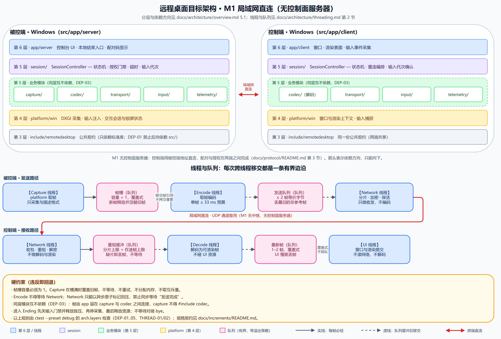

# 远程桌面架构设计

状态：草案，待实现与验收。范围：1 对 1 远程桌面，优先 Windows 被控端与 Android 控制端。
本文描述目标架构；当前能力、已取得的证据与限制以 [README.md](README.md) 为准。
文中的超时和性能预算是设计目标，不能作为已通过验证的结论。

## 1. 目标与边界

目标：

- 用户外出时，手机在局域网或公网连接家中已登录、未锁屏的 Windows 电脑，查看桌面并远程编程。
- 首次在电脑现场完成配对；用户启用无人值守授权后，已受信任的手机可以在电脑无人操作时连接。
- 优先直连，直连失败自动走 TURN 中继。
- 设备有稳定身份，支持授权撤销、断线恢复和会话隔离。
- 媒体链路可测量、可解释，能定位采集、编码、网络、解码和渲染各阶段耗时。

第一版指 M1：Windows 用户会话代理须已启动，Android 应用须在前台；电脑锁屏、注销或切换到安全桌面时结束会话。远程解锁、跨 Windows 用户会话控制、重启后未登录即连接不在 M1 范围内。

第一版不做：

- 文件传输、音频、剪贴板同步。
- 多显示器、macOS/Linux/iOS/Web 全平台同时支持。
- 账号体系、设备分组、计费和运营后台。

这些不是永远不做，而是不要和“1 对 1 连接稳定”同时推进。

同一台被控电脑同一时间只允许一个活动控制端。另一台设备要连接时，必须先结束当前会话，再建立新会话；底层不接受多个控制端并发注入输入，也不做静默抢占。

## 2. 架构原则

1. 控制面与媒体面分离。控制面只负责身份、在线状态、授权、信令和 TURN 凭据，不转发画面。
2. 媒体优先直连，TURN 只做兜底；1 对 1 不需要额外的媒体转发服务器。
3. 状态由 SessionController 统一维护，分别管理设备在线状态与单次远控会话；UI、媒体和输入只消费状态与事件。
4. 平台差异放在适配层。采集、输入注入、窗口和权限各自实现，协议与会话流程保持一致。
5. 先测量再优化。构建通过、合成视频和单次短测都不能当作性能结论。
6. 安全默认开启。配对口令、token、SDP 和屏幕内容都不进常规日志和 Git；显式测量证据按第 8 节管理。

## 3. 总体架构

[](assets/architecture.png "点击查看高清 PNG")

[查看高清 PNG（3480 × 2460）](assets/architecture.png) · [SVG 源图](assets/architecture.svg)

### 3.1 控制面

职责：

- 设备注册：设备 ID、公钥、版本、最近在线时间；上线时校验持钥证明，已有身份不可被覆盖。
- 在线状态：WebSocket 心跳，不保存媒体。
- 会话授权：转发请求，被控端按现场确认或本地无人值守策略批准后，签发绑定双方和权限的短时 token。
- 信令转发：SDP、ICE 候选、会话结束和错误；校验发送者身份与会话归属。
- TURN 凭据：授权后按会话签发短时用户名和密码，限制分配数量与带宽。

不负责：

- 解码、转码、录制、转发画面。
- 保存屏幕截图、按键内容或剪贴板。
- 替代被控端的本地授权。

### 3.2 媒体面

- STUN 用于发现公网地址；TURN 提供中继候选。
- ICE 在同一次协商中收集并检查主机、反射和中继候选，按优先级选择可用路径。
- 优先直连，同时准备 TURN 候选，避免等待直连超时后才申请中继；TURN 只转发加密流量。
- 媒体使用 DTLS-SRTP；输入和会话控制使用 SCTP over DTLS 的 DataChannel。
- 第一版只支持一个视频轨道、一个显示器和一个活动控制端。
- M1 Android 支持可用的 Wi-Fi 与蜂窝网络，解除当前原型仅绑定 Wi-Fi、忽略蜂窝网络的限制。

### 3.3 被控端

Windows 被控端分两种运行形态：

- 用户会话代理：采集桌面、注入输入、显示授权窗口。必须运行在已登录的交互会话。
- 系统服务（后续）：开机启动、更新、拉起用户会话代理，不直接采集桌面。

不能把采集和输入放进 Session 0；SSH 后台会话也不能当作桌面能力验证。

### 3.4 控制端

- UI：设备列表、地址/口令输入、视频显示、工具栏和状态。
- SessionController：连接、授权、重连和结束。
- MediaClient：PeerConnection、渲染和统计。
- InputController：触控、键盘、组合键和输入状态释放。

## 4. 关键决策

| 编号 | 决策 | 备选 | 理由与代价 |
| --- | --- | --- | --- |
| D1 | 第一版继续使用 WebRTC | 自研 UDP/QUIC 协议 | 复用现有链路、拥塞控制、加密和 TURN；代价是 libwebrtc 体积、构建复杂、TURN 带宽成本 |
| D2 | 信令使用 WSS + 版本化 JSON | gRPC、MQTT | 双向、易调试、部署简单；后续消息变多再评估 protobuf |
| D3 | 控制面用 Go，TURN 用 coturn | Node、Rust、自研中继 | 单人可维护；不自研 TURN；生产环境再考虑多节点和区域调度 |
| D4 | 客户端核心逐步抽成 C++ 共享层 | Rust 重写、双端各写一套 | 复用 libwebrtc 和现有 C++；短期先共享协议与状态机定义，平台多了再抽核心 |
| D5 | M1 保留 GN；M2 验证固定版本工件后迁移 Android Gradle 与 Windows CMake | 长期使用 GN overlay | 先保持已验证链路；迁移须验证 AAR、原生库与新构建入口，见 5.2 |
| D6 | 设备持钥认证 + 短时 token；现场配对建立无人值守信任 | 只用配对口令、只用账号密码 | 本地授权绑定控制端公钥，token 绑定会话与权限；口令不作为长期凭据 |
| D7 | M1 信任控制面，采用 TLS + DTLS-SRTP；额外媒体层加密后置 | M1 即防范恶意信令服务器 | TURN 无需获得媒体明文；M1 不承诺抵抗信令服务器替换 DTLS 指纹，见 7.3 |

### 4.1 为什么不是直接照搬 RustDesk

RustDesk 的控制面拆分值得借鉴：会合服务器负责设备 ID 和信令，中继服务器负责直连失败后的转发。但它的传输协议是自研的，客户端核心和 UI 也围绕自己的协议组织。对当前项目，重写传输层的收益小于成本；更合理的做法是把 WebRTC 封装在 `Transport` 接口后面，保留以后替换的可能。

RustDesk 使用 AGPL，参考架构可以，复制代码要先确认许可证是否接受。

## 5. 模块与目录

目标目录只列新增或职责变化的部分：

```text
core/                       # 可选，平台多了再抽
  protocol/                 # 消息类型、版本、错误码
  session/                  # 共享状态机
apps/
  windows/src/
    session/                # SessionController
    signaling/              # LAN 与 WebSocket 信令实现
    media/                  # 采集、编码、统计
    input/                  # 输入注入与按键状态
    platform/               # 窗口、DPI、托盘
  android/src/main/java/... # UI、SessionController、MediaClient、InputController
server/
  signaling/                # Go：认证、设备、在线、信令
deploy/
  coturn/                   # TURN 配置
  docker-compose.yml
scripts/
  webrtc/                   # M1 维护 GN 应用构建；M2 增加工件产出与校验
  latency/                  # 现有测量工具
```

### 5.1 当前代码的演进

| 当前 | 目标 | 动作 |
| --- | --- | --- |
| `apps/windows/src/sender.cpp` | `SessionController`、`MediaPipeline`、`InputService`、`StatsCollector` | 先抽状态机和信令接口，不一次性重写 |
| `apps/windows/src/pairing_server.cpp` | `LanPairingServer` + `SignalingClient` | 两者实现同一个授权/信令接口 |
| `apps/android/.../ProbeActivity.java` | `SessionController`、`MediaClient`、`InputController`、UI | 先拆类，再迁 Gradle |
| `scripts/webrtc/BUILD.gn` | M1 应用与探针构建；M2 工件构建 | 新入口通过两端互通与回归后再切换默认流程 |
| `scripts/latency/` | 观测与回归 | 保留既有口径，新增网络路径预算时显式区分结果 |

### 5.2 构建迁移与切换条件

1. M1 只拆分职责，继续使用现有 GN 构建。Windows 源码移入子目录时，同步修改
   `scripts/windows/build-webrtc-probe.ps1`、`scripts/linux/build-webrtc-probe.sh`
   的组装逻辑与 `scripts/webrtc/BUILD.gn` 的路径，验证 Windows 和 Android 两端构建与互通。
2. M2 从 `scripts/webrtc/webrtc-build-candidate.json` 固定 revision 自建 Android AAR
   和 Windows 原生库，记录源码、依赖、编译参数、ABI、工具链与工件校验值。
   当前清单中的 AAR 打包尚未验证；不能把可执行打包脚本等同于可消费的工件。
3. Android 验证 Java API、JNI 原生库、arm64-v8a、API 26 最低版本与 Release 打包；
   Windows 验证头文件、库、编译器运行时和链接参数一致。新的 CMake 应用入口独立于根目录单帧探针。
4. 新入口须完成真实桌面、配对、输入、统计、结束释放和同版本两端互通回归，并满足第 8 节对应阶段的门槛。
   验证期间保留 GN 回归入口；通过后再同步更新 README、平台说明与 AGENTS 中的现行构建约定，切换默认入口。
5. 第三方 AAR 若改变固定 WebRTC revision 或无法说明构建来源，按依赖升级重新验证两端构建与互通。
   迁移本身不授权更换 WebRTC 版本，也不代表当前已经存在 Gradle 应用工程。

M1 共享协议、状态和错误码的定义及测试向量，两端仍可分别用 C++ 与 Java 实现。
是否增加 C++/JNI 共享运行时，在平台扩展时单独评估。

## 6. 协议与会话

### 6.1 消息、身份与代次

控制面消息使用版本化信封；以下字段为目标协议，现有 LAN 文本协议须由适配层转换：

```json
{
  "v": 1,
  "type": "offer",
  "session": "uuid",
  "negotiation": 1,
  "seq": 12,
  "payload": {}
}
```

- `session` 标识一次授权后的远控会话，新会话使用新 UUID；设备级消息为 `null`。
- `negotiation` 标识本会话内的 SDP/ICE 协商代次，首次为 1，ICE restart 时递增；其他消息为 `null`。
- `seq` 在每个发送者的会话内递增。设备级消息使用当前认证连接内的独立序号，不能比较双方的序号大小。
- 服务端从已认证连接确定发送者，不信任 payload 声明的身份；转发时保留可验证的来源与会话归属。
- 接收端先校验身份、会话和协商代次，再处理序号。已结束会话的任何消息均丢弃，即使其序号更大。
- 不支持的主版本、必需消息类型或权限返回明确错误；新增可选字段可忽略，不自动降级认证。

消息至少包含：

- `auth.challenge`、`auth.proof`、`register`、`heartbeat`：持钥认证、首次注册、上线和保活。
- `session.request`、`session.accept`、`session.reject`：请求、被控端批准与拒绝。
- `offer`、`answer`、`ice`：协商、trickle ICE、候选收集结束；ICE 消息携带对应代次和 ufrag。
- `session.ready`、`input.ready`：确认视频/通道就绪与当前输入代次。
- `bye`、`error`、`token.refresh`：结束、错误和凭据续期。

Windows 固定作为 offer 发起方，包括 ICE restart，避免双方同时发起协商。
候选可先于 SDP 到达，在对应远端描述应用成功后添加；旧代次候选不能加入新协商。

### 6.2 状态机与输入权限

SessionController 统一处理事件，维护两个相互关联的状态：

```text
设备连接：
Offline -> Authenticating -> Online
Online -> Offline                         # 连接关闭或心跳超时
Authenticating -> Offline                 # 认证失败或超时

单次远控会话：
Idle -> Requesting -> Authorizing -> Connecting -> Streaming
Streaming -> Recovering -> Streaming       # 同一 PeerConnection 内的 ICE restart
Requesting / Authorizing / Connecting / Streaming / Recovering -> Ending -> Idle
任意活动状态 -> Failed -> Ending -> Idle
```

被控端收到请求后进入 `Authorizing`，控制端等待该结果；设备保持 `Online` 时，会话结束只回到会话 `Idle`。
新会话重建始终从 `Idle` 重新请求和授权，不从旧会话直接跳回 `Streaming`。

必须保证：

- 被控端原子地保留唯一活动会话槽位，授权过程中也拒绝第二个控制端；失败与结束释放槽位。
- 进入 `Streaming` 须已应用双方描述、PeerConnection 与必要 DataChannel 就绪，且控制端确认收到首帧。
- 仅在 `Streaming`、本地授权有效、token 未过期且输入代次已确认时允许注入输入。
- 已知断线、授权撤销、锁屏、切后台、进入恢复或结束状态时，先禁止输入、清空待执行队列并释放所有按压状态。
  `Recovering` 保留 PeerConnection 与通道以尝试 ICE restart；只有进入 `Ending` 才异步关闭，且不依赖 `bye` 送达。
- 每次暂停后恢复输入都分配新的 `input_epoch`。输入消息带会话 ID、输入代次和序号，过期消息不能在恢复后补执行。
  可靠输入序号与 `pointer_seq` 各自递增，接收端不能用一条通道的序号丢弃另一条通道的消息。
- 异步任务与回调捕获所属会话和对象代次；执行前检查归属，旧对象回调不得修改新会话或注入输入。
- `Failed` 与 `Ending` 幂等，重复通知不重复释放资源；释放失败要显式报告，不能记作正常结束。

### 6.3 DataChannel 与发送队列

| 通道 | 配置 | 用途 |
| --- | --- | --- |
| `control` | 可靠有序 | 会话状态、输入代次、错误和就绪确认 |
| `input-key` | 可靠有序 | 键盘、鼠标按下/释放、点击、滚轮 |
| `pointer` | 无序，`maxRetransmits=0` | 绝对鼠标位置，可丢失旧移动 |
| `file` | 可靠，分片并限速；M1 不启用 | 后续文件传输 |

仅设置无序仍然是可靠传输；`pointer` 还须关闭重传。
同一 PeerConnection 的多个 DataChannel 共用 SCTP association 与拥塞窗口。
分通道可以区分排序与可靠性，不能承诺文件和输入的拥塞隔离。
后续文件传输须限制分片大小、发送速率与缓冲量，实施背压，输入有积压时暂停文件发送；
若仍不满足输入预算，再评估独立传输，其流量仍会竞争实际网络带宽。

移动消息使用递增的 `pointer_seq`；接收端保留最新序号的位置，不能按到达顺序判断新旧。
点击、按下、释放和滚轮消息自带绝对坐标、显示映射版本及当前 `pointer_seq`，
被控端在可靠通道内先定位再执行动作，并更新移动序号下限。

每个可靠鼠标动作还带递增的 `button_seq`，移动消息用 `after_button_seq` 指明生成该移动前的最后一个可靠鼠标动作。
只有依赖动作已执行且仍为当前动作时才注入移动；依赖尚未执行时仅暂存最新移动，按输入队列预算限时等待，
合并移动不重置等待截止时间；依赖已过期则丢弃。按下后的移动须等按下完成，释放后的移动须等释放完成，不能提前执行。
显示映射改变时暂停输入并重新确认；会话或 `input_epoch` 改变时清空依赖与暂存移动。

键盘和按钮事件不能无限积压。初始预算为每端输入队列最多 32 条，单端排队最长 500 ms；
超过预算结束会话并释放输入，不能丢掉部分文字后继续执行 Enter。
队列时间用各端本地单调时钟测量，不相减两端时间戳。

### 6.4 连接、恢复与结束

1. 双方完成第 7 节持钥认证并上线；控制端提交签名请求，被控端按现场确认或本地无人值守策略授权。
2. 控制面核对被控端批准后，签发绑定设备、会话、权限的 token 与 TURN 凭据；Windows 发起 SDP/ICE 协商。
3. 直连和中继候选在同一次协商中检查。就绪条件满足后进入 `Streaming`，开始输入和统计。
4. 媒体路径断开而认证信令仍在线时，进入 `Recovering`，停止输入并释放按压状态；
   Windows 在同一 PeerConnection 中增加协商代次，尝试 ICE restart。恢复成功后重新确认输入代次。
5. ICE 恢复超时、PeerConnection 失败、WSS 关闭或心跳超时，都结束旧会话。
   WSS 重连须重新持钥认证；恢复设备在线状态不能自动恢复旧会话。
6. Android Wi-Fi 与蜂窝网络切换遵循上述规则。若 WSS 也中断，按新会话处理，不能假设 ICE restart 总能保留会话。
   已启用无人值守的受信任控制端可在 60 秒内最多尝试新建会话 3 次，每次重新校验授权；
   现场确认模式须重新取得批准。主动结束、授权撤销、锁屏或切后台后不自动重连。
7. 结束时本地撤销输入权限、释放按压状态并关闭 PeerConnection，通知对方与控制面，停止凭据续发。
   正常关闭尽力释放 TURN allocation；业务授权撤销、凭据失效和中继资源回收分别处理，见 7.4。

### 6.5 初始超时参数

以下为 M1 默认设计值；调整时须同步协议配置和断线/恢复用例：

| 项目 | 默认值与处理 |
| --- | --- |
| 设备心跳 | 双向每 5 秒保活；任一端 15 秒未收到有效心跳/应答，视为离线并结束活动会话 |
| 单次持钥挑战 | 30 秒内有效，一次使用，绑定当前 WSS 连接 |
| 会话授权请求 | 60 秒；超时拒绝并释放会话槽位 |
| 首次媒体连接 | 获批后 30 秒内完成，否则结束会话 |
| ICE 恢复 | 最长 10 秒；失败后结束，再按授权策略请求新会话 |
| WSS 重连 | 1、2、4、8、15 秒退避，上限 15 秒并加随机抖动；不能绕过会话重建次数限制 |
| 会话 token | 5 分钟有效，提前 60 秒申请续期；到期仍未续成则结束会话 |
| TURN 临时凭据 | 10 分钟有效；有效会话提前续发，不能据此限制已有 allocation 的持续时间 |

## 7. 安全模型

### 7.1 设备注册与持钥认证

- 两端安装时生成设备密钥，v1 使用 ECDSA P-256/SHA-256；Windows 使用系统凭据保护能力，
  Android 使用 Keystore 保存私钥。公钥使用 SPKI DER，签名使用 ASN.1 DER，传输采用 base64url。
- 首次注册前，服务端提供随机 nonce；设备签署包含用途、服务端标识、nonce、公钥指纹和有效期的挑战。
  验证后由服务端分配随机设备 ID，绑定公钥。相同公钥恢复原绑定，客户端不能提交已有 ID 覆盖他人公钥。
- 后续上线、WSS 重连都重新验证持钥证明，挑战绑定当前连接，消费后不可重放；设备 ID 不是认证凭据。
  签名输入使用协议 v1 规定的规范化编码，并提供测试向量，不能依赖 JSON 字段排列或任意文本拼接。
- v1 换钥按新设备登记：本地重新确认信任并撤销旧身份。私钥丢失不能只凭设备 ID 重设公钥，
  保留同一 ID 的密钥轮换留待后续设计。

### 7.2 现场授权与无人值守授权

M1 采用设备信任名单，默认关闭无人值守：

1. 首次在 Windows 现场使用现有证书绑定的 LAN 配对通道，校验一次性配对口令并交换设备 ID 与公钥。
   用户在电脑上明确启用无人值守、批准具体控制端和权限；Android 同时保存被控端身份。
2. 配对口令保留 5 分钟、单次会话使用和失败限流规则，只经已验证的信令通道提交；
   不因成功建立一次普通会话而自动添加长期信任，也不向控制面保存可复用口令。
3. 后续请求携带控制端签名，覆盖双方设备 ID、会话 ID、请求 nonce、权限和有效期。
   被控端先验证签名与防重放，再选择现场人工批准，或核对本地无人值守名单和当前桌面状态后放行。
4. 被控端签署批准结果，绑定原请求、会话、权限与授权版本；控制面验证后签发 token。
   token 至少绑定签发者/受众、双方设备、控制端公钥指纹、会话、权限、授权版本、唯一编号及有效期。
   被控端核对 token 和本地批准；服务端 token 不能扩大本地授权。
5. 权限至少区分查看和输入，续期重新检查本地授权，不能从旧 token 派生更大权限。
   本地移除控制端或关闭无人值守立即结束对应会话；再次连接必须重新配对或现场确认。

无人值守允许已授权手机在电脑无人操作时连接，仍要求代理运行且交互桌面可用。
设备密码、2FA 可作为后续附加因素；M1 不提供跳过设备信任名单的密码回退。

### 7.3 信任边界与隐私

- 信令使用 WSS/TLS，校验服务器身份；服务端按连接、设备和目标限制认证、授权与信令速率。
- M1 信任控制面正确路由信令和传递 DTLS 指纹；DTLS-SRTP 与 SCTP/DTLS 在直连和 TURN 路径中都加密。
  TURN 在该模型下无法解密画面，但可看到连接元数据；M1 不承诺抵抗恶意信令服务器替换指纹。
- 若后续要降低控制面信任，先设计基于已配对设备密钥的会话及 DTLS 指纹绑定；
  是否再增加媒体层 E2EE 单独评估，增加一层加密本身不能替代设备身份认证。
- 被控端显示正在被控制的提示与本地结束入口。退出、锁屏、注销、安全桌面或 Android 切后台结束会话；
  不远程处理 UAC/安全桌面，不在 Session 0 采集或注入输入。
- 常规日志不记录 SDP、token、配对口令、TURN 密码、屏幕内容和按键内容。
  显式开启的测量证据仅存本地受控位置，不作为常规遥测、不提交 Git，具体约定见第 8 节。

### 7.4 TURN 凭据与资源回收

M1 使用 coturn REST/HMAC 临时凭据，用户名包含到期时间与业务会话标识，仅对获批会话签发。
停止续发不等于立即吊销已签发凭据；凭据到期也不保证已建立并持续维护的 allocation 立即结束。

- 结束远控依赖被控端撤销输入授权和关闭 PeerConnection，不等待 TURN 清理，也不依赖服务端收到 `bye`。
- 正常结束由 ICE/TURN 客户端尽力删除 allocation；异常退出后未刷新的 allocation 按服务端寿命到期。
- coturn 配置每用户名与总 allocation 配额、带宽上限，观测结束后的资源残留；
  拒绝向已结束会话续发凭据。M1 不承诺对未过期 REST 凭据逐条即时吊销。
- 若需要服务端强制清理，须关联业务会话与全部 coturn allocations，通过管理能力终止；
  若还要禁止未过期凭据重新分配，须额外集成逐凭据拒绝机制并验证认证缓存行为。
  轮换共享 secret 影响多组凭据，不能作为逐会话撤销办法。

## 8. 观测与验收

### 8.1 指标与证据边界

- 连接尝试数、成功数、失败原因、最终选中的 candidate pair 与直连/中继路径。
- 首帧时间：控制端发起请求到本地首帧渲染回调，使用同一单调时钟，包含授权等待并标注授权模式。
- 软件处理耗时：各端本地阶段分别统计；禁止直接相减 Windows 与 Android 的时间戳。
- 操作到反馈帧耗时：沿用现有同钟采样与画面复核口径，标明 `VideoSink.onFrame` 入口终点。
- 物理画面显示延迟、物理操作反馈延迟：使用独立外部测量；软件回调与统计不能替代物理显示结果。
- 分辨率、接收端解码帧率、码率、丢包、抖动、冻结次数/时长、解码耗时，以及采样覆盖率。
- ICE 恢复和新会话重建耗时分别统计；记录会话异常结束、授权拒绝、按键残留与资源回收失败。

软件处理耗时、操作到反馈帧耗时和物理画面延迟分别命名，用户可见概念遵循 [CONTEXT.md](CONTEXT.md)。
未取得对应证据的指标标记为未测，不能从 RTT、编码时间或首帧回调推算物理画面延迟。

### 8.2 现有 LAN 基线与测量方法

沿用 [baseline.py](scripts/latency/baseline.py) 的既有规则，不修改历史通过条件：

- 预热至少 30 秒，连续采集 600 秒；按现有固定工作负载完成 5 轮，每轮包含文本提交、编译开始、程序启动和中断返回。
- 20 个操作样本均完成复核，并保留失败、超时和不可读状态；采集完整不代表性能达标。
- 提交与解码分辨率均为 1280×720，时间加权平均解码帧率至少 30 fps；统计覆盖率至少 99%，
  无报告冻结、无丢失统计序号，才可按现有规则判定 LAN 720p30 通过。
- 复用 `scripts/latency/` 的本地阶段、基线与弱网工具。网络路径、设备、源码/工件版本、编码配置和测量开关须随实验记录。
- 现有工具只汇总反馈耗时中位数与极值；M2 增加分位数分析时，固定定义 P95 为排序后第 `ceil(0.95*n)` 个值。
  四类操作分别报告样本数、P50、P95、失败和超时数；每类至少 20 个有效样本才给出 P95 验收结论。

原始画面、主机信息、SDP 与配对材料只存 `.local/` 或 `build/` 等受控本地位置，不提交 Git。
新增分析不默认取得读取或复核屏幕内容的授权；按现有测量工具的复核来源和授权约定执行。

### 8.3 M2 初始性能预算

下表是待测的设计目标，不是现有实测结果。每条路径先记录真实 RTT 与可用带宽；
超出条件的运行归入弱网或现场观察，不能用于宣称通过该预算，也不能隐去失败结果。
预算调整须记录版本与原因，既有 LAN 720p30 标准保持独立。

| 路径 | 正常网络条件 | 720p 解码帧率 | 每 10 分钟冻结上限 | 首帧 P95 | 操作到反馈帧 P95 |
| --- | --- | --- | --- | --- | --- |
| LAN 直连 | RTT ≤ 10 ms，可用带宽 ≥ 10 Mbps | ≥ 30 fps | 0 次 | ≤ 5 s | ≤ 200 ms |
| 公网直连 | RTT ≤ 80 ms，可用带宽 ≥ 10 Mbps | ≥ 24 fps | 1 次且总计 ≤ 1 s | ≤ 10 s | ≤ 350 ms |
| TURN 中继 | 路径 RTT ≤ 150 ms，可用带宽 ≥ 10 Mbps | ≥ 24 fps | 2 次且总计 ≤ 2 s | ≤ 15 s | ≤ 500 ms |

- 首帧预算使用预授权的无人值守模式，计入自动授权与 ICE/TURN 协商；现场人工确认的等待时间另列。
- 正常网络不额外注入丢包或限流，路径 RTT 取选中 candidate pair 的观测值，带宽条件指桌面到手机方向；保留自然丢包数据。
- 每条路径至少完成一次 10 分钟固定工作负载和 20 次无人值守连接尝试，连接须全部成功。
  反馈样本不足时按同条件重复采集，不混合三条路径、四类操作或不同版本。
- 性能窗口统计覆盖率至少 99%，无丢失统计序号；四类操作的失败与超时须为 0，不能只用成功样本计算达标。
- 公网和中继的 24 fps 预算不能称为 720p30 通过；降分辨率或帧率的自适应结果单独报告。
- 编码、采集或渲染瓶颈按证据安排优化；硬件编解码可进入 M1/M2，不以 M3 为固定起点。

### 8.4 可靠性、安全与弱网矩阵

| 场景 | 检查与预期 |
| --- | --- |
| 三种网络路径 | 局域网、公网直连、强制 relay 与实际直连不可用时的 TURN 回退；用选中候选类型证明路径 |
| 无人值守 | Windows 无人点击即可连接；未信任手机、已撤销手机、超时/重放请求、伪造设备身份均被拒绝 |
| 会话隔离 | 连接中及已连接时拒绝第二端；新会话期间注入旧 token、旧回调与高序号旧消息均无效 |
| 断线与恢复 | 按住按键/鼠标时断网、WSS 断开、ICE 失败与网络切换；各路径均释放输入，恢复后不补执行旧队列 |
| 输入顺序 | 移动/点击乱序、释放后移动先到、按下后移动先到、拖拽/滚轮、布局/输入法、组合键与长按；验证按钮依赖、坐标及输入代次 |
| 桌面与生命周期 | 锁屏、注销、安全桌面、切后台应结束；M1 覆盖单显示器 DPI，M2 再验证多显示器与旋转 |
| 授权与 TURN | 本地撤权先停止控制，token 不得越权续期；区分停止续发、凭据过期、正常与异常 allocation 回收 |
| 弱网单变量 | 分别限制为基线码率的 75%、增加单向 50 ms 延迟、随机丢包 1%，一次只改一项，各持续 10 分钟 |
| 1 小时会话 | 无崩溃、按键残留或持续资源增长；Windows private bytes 与 Android PSS 分别取样并检查关闭后回收 |

弱网运行记录帧率、反馈 P95、失败率和冻结，不套用正常网络预算；恢复原网络后 30 秒内恢复到对应路径预算。
如需重建会话，仍受授权、重试次数与前台条件约束。每次网络实验结束恢复原设置。

10 分钟、1 小时与更长稳定性结论分别记录；短测不外推长稳结果。
当前尚无物理延迟测量，不把本节软件预算写成物理延迟承诺。

## 9. 里程碑

### M0：现有局域网原型与性能基线

已完成能力见 README。保留现有局域网链路、采集和测量工具作为回归基线。
十分钟基线已采集，但 720p30 尚未通过；继续完成单变量弱网与瓶颈优化对照，保留未达标结果。
该工作可与 M1 协议拆分并行，公网信令和 TURN 不替代采集、编码、渲染的性能优化。

### M1：公网与无人值守可连

交付：

- 设备注册、持钥认证、在线心跳与本地信任名单；代理仍在已登录、未锁屏的用户会话中运行。
- WebSocket 信令和版本化消息，现场确认与预授权无人值守两条授权路径。
- coturn 部署、短时凭据、直连不可用时自动选择中继，并明确凭据与 allocation 的回收边界。
- 设备/会话状态、ICE 恢复与新会话重建、旧事件隔离、输入暂停和按压释放。
- Android Wi-Fi、蜂窝网络与网络切换；保留现有 GN 构建和 LAN 手动配对排障入口。

验收：

- 同一对真机在 LAN、公网直连、TURN 三条路径各连续建立 10 次会话并操作真实桌面，全部成功；
  至少一次验证直连不可用时自动选择 TURN，不能只用强制 relay 代替回退测试。
- 完成首次现场授权后，用户离开电脑即可连接；无人值守重建须重新请求并校验授权。
- 拒绝未信任/已撤销设备、伪造持钥证明、重放请求、越权/过期 token 和第二控制端。
  结束后保持设备在线，旧会话的消息、回调和输入均不再生效，按压状态已释放。
- 覆盖 WSS 断开、ICE 失败、Wi-Fi/蜂窝切换与桌面/应用生命周期；
  记录断线判定时间、恢复路径、失败与资源残留，不把 M1 功能通过写成性能达标。

### M2：日常可用

- Windows 用户会话代理的托盘、本地结束入口、登录启动与授权管理体验。
- 按 5.2 验证固定版本工件，完成 Android Gradle 与 Windows CMake 应用构建切换。
- 鼠标光标、DPI、多显示器与旋转；剪贴板、文件传输、音频按需独立验收。
- 指标面板、单变量弱网回归与基于瓶颈证据的软/硬件编解码优化。

验收：通过 8.2 的 LAN 720p30 标准和 8.3 各路径预算；完成 8.4 的对应功能、弱网与 1 小时稳定性检查。
未实现的可选功能保持未验收；功能数量和构建切换不替代日常可用门槛。

### M3：产品化

- macOS/Linux 被控端，iOS/Web 控制端。
- 更广设备的硬件编解码与弱网优化；设备密钥绑定 DTLS 指纹和额外媒体层 E2EE 单独评估。
- 账号、设备分组、审计、TURN 多节点，以及更严格的中继资源强制回收与凭据撤销。
- 系统服务、登录前或锁屏场景等扩展另定 Windows 安全与权限边界，不从用户会话代理能力推导。

## 10. M1 任务清单

- [ ] 固定协议 v1 信封、身份/会话/协商代次、序号作用域、错误码与版本规则。
- [ ] 定义挑战签名和授权签名的规范化编码、测试向量、设备注册/换钥与防重放规则。
- [ ] 定义双方设备、权限、授权版本与 token 的绑定和续期规则。
- [ ] 定义设备与会话状态、就绪条件、超时、输入代次和结束释放顺序。
- [ ] Windows 抽出 SessionController、SignalingTransport 与本地授权策略；保留 LAN 和文件信令调试实现。
- [ ] Android 抽出 SessionController、SignalingClient、MediaClient 与 InputController，接入 Wi-Fi/蜂窝网络事件。
- [ ] 拆目录时同步两个组装脚本及 GN 路径，验证两端构建与 LAN 回归。
- [ ] 实现 Go 信令服务的持钥认证、注册、在线、会话授权、信令校验与转发。
- [ ] 实现首次现场配对、无人值守信任名单、本地撤销和单活动会话约束。
- [ ] 部署 coturn，接入短时凭据、配额、带宽限制与 allocation 回收观测。
- [ ] 实现 ICE restart、独立的新会话重建、WSS 重认证与受限自动重试。
- [ ] 实现有界输入队列、按压释放、跨通道按钮依赖/坐标/序号和旧输入代次拒绝。
- [ ] 真机验证三种网络路径、自动 TURN 回退、无人值守及第 9 节 M1 的负向验收。
- [ ] 增加连接/恢复指标和不含敏感内容的日志，复用现有性能基线并明确未达标项。

## 11. 风险与未决问题

- TURN 带宽和节点成本：按会话标识观测配额与资源残留；商业产品需要区域调度和成本预算。
- REST 凭据残留：M1 无逐凭据即时吊销；恶意持有者可能在到期前重建，已有 allocation 可能继续维护。
  服务端强制回收与拒绝重新分配需要额外机制，不把短 TTL 当成完整解决方案。
- WebRTC 工件维护：M2 优先固定 revision 自建；AAR 打包、Windows 原生库导出与新入口仍待验证。
- Windows 服务与用户会话代理的边界：M1 只接受已登录、未锁屏桌面，服务与安全桌面扩展另行设计。
- 编码器兼容性：硬件 H.264/HEVC/AV1 在不同设备上的可用性，由瓶颈和互通证据决定优先级。
- 性能预算：8.3 为初始目标，公网实际网络可能不满足测试条件；预算调整须保留理由与历史结果。
- 信任边界：M1 信任控制面；降低该信任需要端点认证 DTLS 指纹，不能仅增加媒体加密层。
- 账号体系是否必要：M1 使用设备身份与本地信任名单，账号、设备分组与恢复流程后续评估。
- 许可证：参考 RustDesk 架构时避免直接复制 AGPL 代码。
- 国内网络：UDP 质量、TURN over TCP/TLS 443 回退、跨运营商延迟。

## 12. 协议依据

- [RFC 8831 §5、§6：WebRTC DataChannel、共享拥塞窗口与可靠性](https://www.rfc-editor.org/rfc/rfc8831.html)
- [RFC 8260：SCTP 消息交织及其拥塞控制约束](https://www.rfc-editor.org/rfc/rfc8260.html)
- [RFC 8656 §8：TURN allocation 刷新与删除](https://www.rfc-editor.org/rfc/rfc8656.html#section-8)
- [coturn TURN REST API 与临时凭据说明](https://github.com/coturn/coturn/blob/master/README.turnserver)
