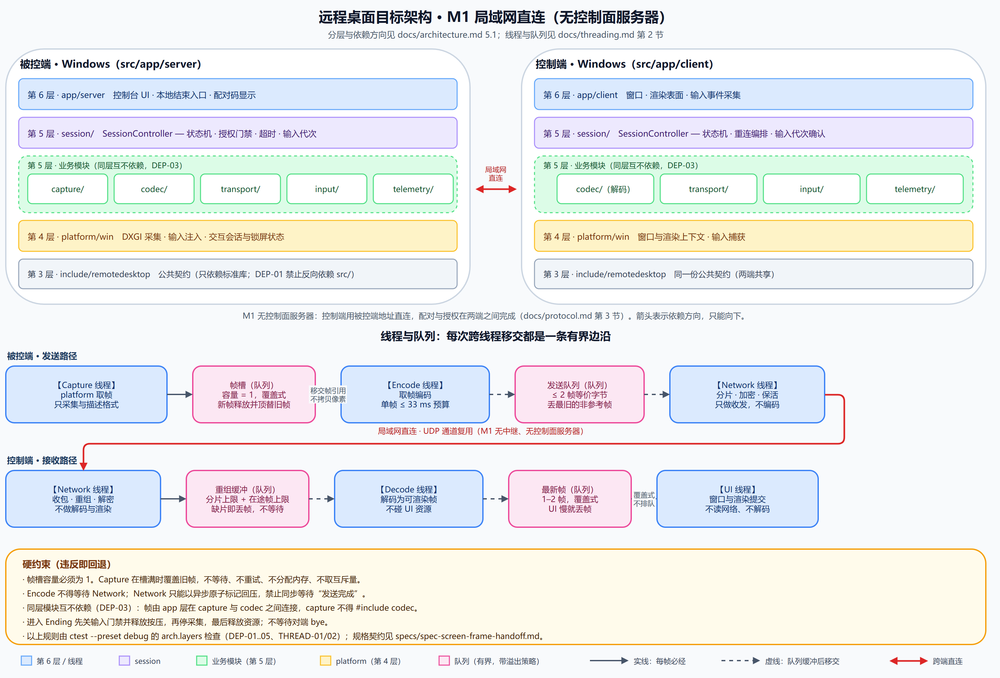

# 远程桌面

跨平台 C++ 远程桌面：被控端捕获屏幕并注入输入，控制端渲染画面并发送控制事件。
目标低延迟、高帧率、输入跟手。

**当前处于设计阶段，只有构建与测试回路可用。** 仓库还没有业务实现：`src/` 只有一个空的接口库，
`tests/` 只有回路自检。`cmake --preset debug`、`cmake --build --preset debug`、
`ctest --preset debug` 三条命令已实际跑通，见 `test-results/verification-loop.log`。

## 约束总纲

[AGENTS.md](AGENTS.md) 是强制约束：C++20 + CMake Presets/Ninja + CTest，SDD 规格先行，
TDD 红绿重构，线程模型与延迟预算不得为功能让步。任何代码变更先满足该文件。

## 构建与验证

```bash
cmake --preset debug          # 配置：Ninja + Debug + C++20 + BUILD_TESTING
cmake --build --preset debug  # 构建
ctest --preset debug --output-on-failure   # 全量测试
ctest --preset debug -R smoke --output-on-failure   # 只跑回路自检
```

另有 `release` preset（`cmake --preset release` 等），用于验证“断言降级为计数”的
Release 行为。它不出性能结论，只是让 Debug/Release 两种分支都被覆盖。

- `debug` preset 定义在 [CMakePresets.json](CMakePresets.json)，警告当错误（`RD_WARNINGS_AS_ERRORS=ON`）。
- GoogleTest 由 `FetchContent` 固定为 `v1.18.0`，来源与 tag 写在 preset 变量
  `RD_GTEST_REPOSITORY` / `RD_GTEST_TAG`，不在各处重复声明。
- 无法访问该仓库时，可把源码放到任意目录并加
  `-DFETCHCONTENT_SOURCE_DIR_GOOGLETEST=<目录>`；这只改变取源方式，不改变构建入口。
- 新增测试目标必须接 `gtest_discover_tests()`，否则 CTest 看不到用例。
- 两个非业务用例把文档约束变成可执行检查，任一失败即 `ctest` 失败：
  - `spec.structure` —— `specs/` 的状态行、必需章节、验收用例编号
  - `arch.layers` —— 依赖方向（DEP-01..05）与线程归属注释（THREAD-01/02）
  单独跑：`ctest --preset debug -R "spec.structure|arch.layers" --output-on-failure`。

## 文档

| 文件 | 内容 |
| --- | --- |
| [AGENTS.md](AGENTS.md) | 构建命令、技术栈锁定、SDD/TDD、线程模型、代码与禁止事项 |
| [规格目录说明](specs/README.md) | 规格命名、模板结构、审批状态与自动校验 |
| [规格：局域网纵向切片](specs/spec-lan-vertical-slice.md) | M1 的范围、接口契约、不变量、验收场景（里程碑级，`draft`） |
| [规格：帧移交](specs/spec-screen-frame-handoff.md) | 屏幕捕获帧的所有权、单槽覆盖与线程约束，16 条验收场景（功能级，`approved`） |
| [架构设计](docs/architecture.md) | 分层、依赖方向（含判定规则）、关键决策、模块所有权、安全模型、里程碑 |
| [控制协议 v1](docs/protocol.md) | JSON 信封、配对与授权、媒体参数协商、校验顺序 |
| [协议测试向量](docs/protocol/vectors/envelope.json) | 机器可读的输入与预期结果，供两端编解码测试共用 |
| [线程模型](docs/threading.md) | 线程清单、八条交接边沿的判定规则、队列上限、延迟预算、评审清单 T-01~T-09 |
| [平台抽象层](docs/platform-abstraction.md) | 采集、注入、会话状态、渲染的接口契约与错误码 |

## 参考报告

`docs/references/` 存放**第三方产品的观察记录**，与本项目契约无关，
不被 `specs/` 或 `src/` 引用，也不构成选型依据：

- [RustDesk 安装包观察与源码参考](docs/references/RUSTDESK-REFERENCE.md)
- [网易 UU 远程安装包观察](docs/references/CROSS-PLATFORM-REFERENCE.md)

## 架构图

[](assets/architecture.png)

- [高清 PNG（3102 × 2104）](assets/architecture.png)
- [可编辑的 draw.io 源文件](assets/architecture.drawio)

图内容与 `docs/architecture.md` 第 3、5.1、6.3 节对应。改图先改 `.drawio` 再导 PNG，
方法见 [drawio-architecture](.agents/skills/drawio-architecture/SKILL.md)。
参考报告自己的图在 `assets/references/`。
