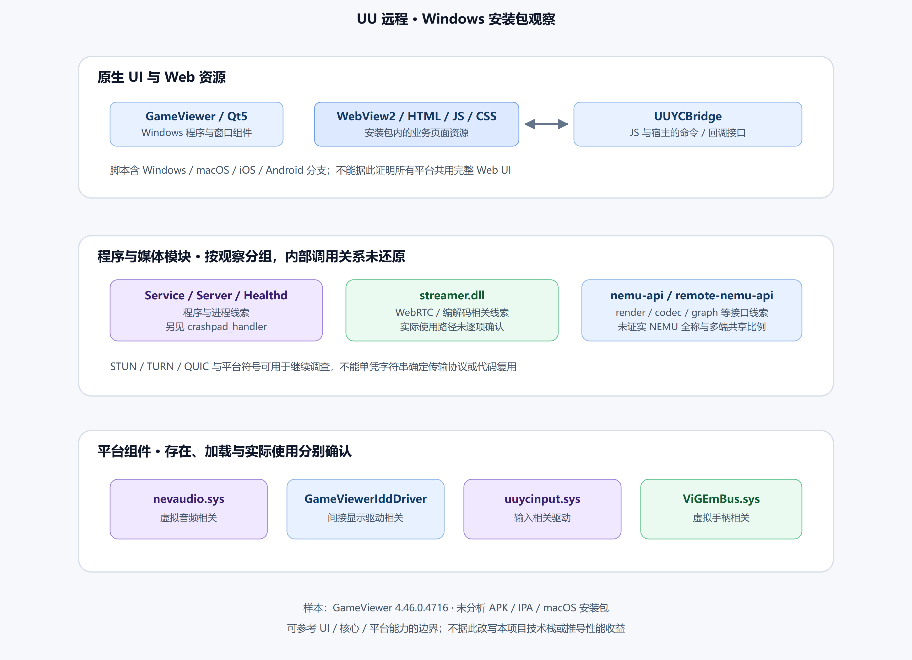

# 跨平台架构参考：网易 UU 远程安装包观察

本文保留 2026-11-16 对本机网易 UU 远程（GameViewer）Windows 安装包的观察，
用于比较 UI、媒体与平台适配的职责边界。本项目目标架构以 [ARCHITECTURE.md](../ARCHITECTURE.md) 为准。

证据包括文件、模块、进程、驱动、网络状态、二进制字符串与本地 JavaScript。
未分析 Android APK、iOS IPA 或 macOS 安装包，也未通过抓包还原媒体协议。
因此，本文不把 Windows 中的跨平台符号或 JS Bridge 分支当作多端实现的完整证明。

## 1. 目标与结论范围

要回答的问题是：该 Windows 产品怎样划分原生能力和业务页面，其中哪些边界适合本项目？

可以观察到 Qt5/WebView2 相关组件、带多平台分支的 JavaScript Bridge、媒体相关 DLL、
多个程序组件及虚拟设备驱动。它们为分层设计提供参考，但不足以证明所有平台共享同一套
C++ 核心和完整 Web UI，也不能据此判定这些方案的性能收益。

## 2. Windows 安装包中的组件

[查看高清 PNG](../assets/uu-remote-architecture.png) · [SVG 源图](../assets/uu-remote-architecture.svg)

图中按职责整理观察到的组件，不表示已还原完整调用图或进程间通信拓扑。

### 2.1 媒体相关模块

| 观察 | 可以支持的判断 | 尚未证明 |
| --- | --- | --- |
| `streamer.dll`，约 18 MB；包含 WebRTC、编解码、STUN/TURN 和 QUIC 相关字符串 | 安装包包含媒体与网络相关实现或依赖 | 哪条连接实际使用何种协议、是否修改 WebRTC、各编解码器是否可用、QUIC 的具体用途 |
| `nemu-api.dll`、`remote-nemu-api.dll`；含 render/codec/encode/decode/graph 等词 | 存在媒体处理接口或模块 | NEMU 的英文全称、模块内部架构及多端共享比例 |
| Windows、Android、iOS、macOS、TV、Cloud 等平台标识与部分平台相关符号 | 代码或资源包含跨平台条件和接口线索 | 各平台都使用同一套 C++ 运行时，或完整功能均由它实现 |

字符串和 DLL 大小不衡量功能覆盖、代码复用比例或运行性能。
Android/JNI、Objective-C 相关线索不能替代对移动端安装包及调用路径的直接分析。

### 2.2 UI 与 JavaScript Bridge

Windows 安装目录包含 Qt5、Microsoft Edge WebView2 和 HTML/JS/CSS 资源，
支持将 Windows UI 理解为原生组件与内嵌 Web 内容的组合；具体哪些页面或视频区域使用哪种渲染方式，
仍须逐路径确认。

本地 `bin/html/error/uuycbridge.js` 包含以下平台分支：

| 平台分支 | 代码中的底层调用 |
| --- | --- |
| Windows | `chrome.webview.hostObjects.host.JSCallCppWithCallbackParameter(json, callbacks)` |
| macOS | `window.prompt(method, json)` |
| iOS | `window.webkit.messageHandlers.UUYCBridge.postMessage({method, params})` |
| Android | `window.AndroidUUYCBridge.execute(json)` |

可见 API 包括 `getTicket`、`getHeaderParams`、`syncClientStatus`、`setNavConfig`、
`getOriginUIConfig`、`setOriginUIConfig`、`getSystemConfig`、`setSystemConfig`、
`sendRenderFinishEvent`、`onHandleUri`、`onCopy`、`onClose` 和 `onBridge(method, params)`。

这些分支证明这份脚本为多个宿主预留接口，不能证明所有产品页面跨端共用、所有移动端均采用 WebView，
也不能排除原生 UI、Flutter 或其他实现。视频帧是否经过该 Bridge 未被验证。

### 2.3 程序组件与平台能力

安装及进程观察涉及 `GameViewer.exe`、`GameViewerService`、`GameViewerServer`、
`GameViewerHealthd` 和 `crashpad_handler` 等名称。这说明产品不只有 UI 文件，
但单凭名称不能确定完整的守护、启动顺序、IPC 关系或每个进程承担的功能。

| 组件 | 观察到的能力线索 | 边界 |
| --- | --- | --- |
| `nevaudio.sys`、`Nevaudiosdk.dll` | 虚拟音频相关组件 | 不代表所有音频路径均依赖该驱动 |
| `GameViewerIddDriver.dll` | 间接显示驱动相关组件 | 未覆盖真实会话中的启用与切换行为 |
| `uuycinput.sys` | 输入相关驱动 | 未验证具体输入路径、权限范围或延迟收益 |
| `ViGEmBus.sys` | 虚拟游戏手柄相关组件 | 不由此推导普通桌面控制必须安装此驱动 |
| ConPTY 相关字符串 | 终端或伪控制台相关线索 | 未还原调用流程与产品入口 |

驱动文件存在、已安装、已加载及被某条远控路径实际使用，是不同层次的证据。
本次 Windows 观察不能确认 Android MediaProjection/无障碍实现，也不能判定 iOS 控制能力的完整边界。

## 3. 对本项目有用的设计模式

### 3.1 可以采用的职责边界

1. **业务 UI 通过命令与事件访问核心。** 页面或原生界面不直接拥有信令、输入授权和媒体资源。
   Bridge 或 FFI 需要清楚的参数、对象归属和错误语义；视频使用原生渲染接口。
2. **平台能力独立适配。** 桌面采集、输入注入、权限与窗口归各平台实现；协议与会话规则单独定义。
3. **服务和交互代理分别设计。** 本项目后续若增加系统服务，服务负责启动和管理，
   采集与输入仍遵循交互会话权限，不能因参考产品存在服务就推导 Session 0 可采集。

这些模式也能从本项目当前问题中独立得到，不需要先证明 UU 全部内部实现。

### 3.2 共享代码的实施顺序

本项目已有 Windows/Linux 被控端及可移植接口的构建复用需求。
按 [架构决策 D4](../ARCHITECTURE.md#4-关键决策)，先统一协议、状态、错误码、签名编码与测试向量，
再逐步抽出桌面公共帧接口、统计和 WebRTC 会话封装。Android 保留 Java 实现。

完整 C++/JNI 运行时需要额外维护 ABI、线程、资源释放和多平台工具链；
其收益应由实际重复代码和维护成本说明，不能把本次 Windows 观察当作已验证的商业复用模型。

### 3.3 UI 与驱动的选择条件

WebView 共享业务页面可以作为多端 UI 的备选，需要维护 Bridge、各平台容器、资源打包和更新。
本项目当前 Android 使用 Java，Windows 使用现有原生窗口；没有足够理由为 M1 更换 UI 技术。

本项目 M1 继续使用用户态采集与输入。虚拟显示、音频或输入驱动各自需要明确场景、权限、签名与部署验证，
不能仅因为参考产品带有驱动，就将其纳入性能优化或必需依赖。
后续移动端是否支持被控角色，应按平台文档和直接验证确定，再声明具体能力。

## 4. 与本项目决策的对应

| 参考线索 | 本项目采用的原则 | 实施阶段 |
| --- | --- | --- |
| 媒体模块与业务 UI 分开 | UI 只处理命令/事件，媒体资源有明确所有者 | M1，见架构 5.3 |
| 平台相关符号与接口 | 公共协议和桌面模块配合平台适配层 | M1 逐步抽取；Android JNI 另行评估 |
| JS Bridge 多宿主分支 | 作为多端业务界面的备选接口模式 | 有明确 UI 复用需求时评估 |
| QUIC 相关字符串 | 仅作为待核实线索 | 不据此改变 D1 的 WebRTC 路线 |
| 服务、独立程序与驱动 | 分别设计用户会话、权限与部署边界 | M1 用户会话代理；服务和驱动另定范围 |

## 5. 证据来源与边界

- 安装位置：`D:\APP\base\Netease\GameViewer\`，观察版本 `4.46.0.4716`。
- 原观察手段：文件清单、版本、进程与模块、字符串、端口和驱动列表，以及本地 JS 读取。
- 未分析移动端或 macOS 安装包；未反编译、运行时注入或抓取媒体流量。
- 文件名、依赖与条件分支用于提出可核实假设，不作为具体功能已启用或多端实现一致的证据。
- 图示保留上述证据边界；接口细节与性能判断需要额外的直接证据。

## 6. 相关参考

- [ARCHITECTURE.md 决策 D4](../ARCHITECTURE.md#4-关键决策)
- [ARCHITECTURE.md 5.2 构建迁移与切换条件](../ARCHITECTURE.md#52-构建迁移与切换条件)
- [RUSTDESK-REFERENCE.md：RustDesk 安装包观察与源码参考](RUSTDESK-REFERENCE.md)
