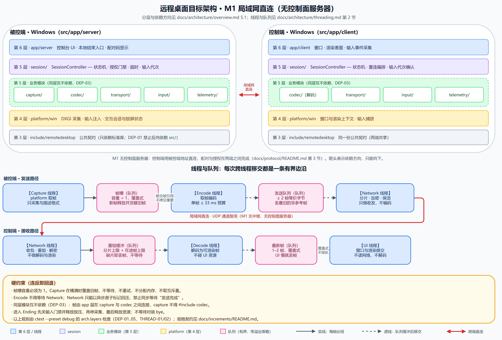

# 远程桌面架构设计

status: draft

状态：设计草案，无实现。范围：1 对 1 远程桌面，Windows 被控端优先，控制端首批覆盖 Windows，
Android 控制端按 `docs/increments/001-lan-vertical-slice/spec.md` 的待决项单独批准。

本文与 [AGENTS.md](../../AGENTS.md) 是同一套约束：技术栈、构建入口、线程模型、延迟预算、
代码约定以 AGENTS.md 为准，本文只展开分层、数据流和模块职责。两者冲突时以 AGENTS.md 为准，
并回改本文。协议细节见 [控制协议](../protocol/README.md)，线程与队列细节见 [threading.md](threading.md)，
平台接口契约见 [platform-abstraction.md](platform-abstraction.md)。

文中所有超时、容量和性能数字都是设计目标，不是实测结果。当前仓库只有构建与测试回路：
`CMakeLists.txt`、`CMakePresets.json`、`include/` 下的空接口库与 `tests/smoke/` 的回路自检，
没有任何业务实现，也没有可引用的性能证据。

## 1. 目标与边界

目标：

- 用户在局域网内用控制端查看被控端真实桌面，并远程操作鼠标和键盘；输入要跟手。
- 延迟预算：局域网端到端 **< 50 ms**，广域网 **< 150 ms**；帧捕获周期上限 33 ms（30 FPS）。
- 媒体链路可测量、可解释，能区分采集、编码、传输、解码、渲染各阶段耗时。
- 同一被控端同一时间只有一个活动控制端；结束后能立即重建新会话。

第一版（M1）范围：

- Windows 被控端运行在已登录、未锁屏的交互会话；锁屏、注销、安全桌面即结束会话。
- 同一局域网内直连；公网、NAT 穿透、中继不在 M1 内。
- 单显示器、单视频轨道、单活动控制端。
- 输入能力限于查看、指针定位/点击、键盘与可打印 ASCII 文本。

M1 明确不做：

- 文件传输、音频、剪贴板同步。
- 无人值守授权、多控制端并发、账号体系。
- macOS/Linux/iOS 被控端与 Web 控制端。

这些不是永远不做，而是不和“1 对 1 局域网连接稳定、输入跟手”同时推进。

## 2. 架构原则

1. **先测量再优化。** 构建通过、合成画面和单次短测都不构成性能结论；没有延迟数据不进热路径。
2. **线程边界即架构边界。** Capture 只采集，Encode 只编码，Network 只收发，UI 只渲染与采集输入事件。
3. **平台差异只存在于 `src/platform/`。** 业务与协议代码不出现 `SendInput`、XTest、Android API。
4. **有界队列，明确丢弃策略。** 任何热路径队列都必须有容量上限与溢出行为，不允许无界缓冲。
5. **状态单一所有者。** 会话状态由 SessionController 串行持有；其他模块只消费事件、不各自记账。
6. **安全默认开启。** 配对口令、会话密钥、屏幕内容和按键内容不进日志、不进 Git。
7. **不自研密码学。** 加密、签名和随机数一律使用经验证的第三方库；库的引入按 AGENTS.md §3 走审批。
8. **规格先行。** 功能代码之前先在 `docs/increments/<NNN>-<slug>/spec.md` 写清接口契约与不变量。

## 3. 分层与数据流

[](../../assets/architecture.png "点击查看高清 PNG")

[查看高清 PNG（3102 × 2104）](../../assets/architecture.png) · [可编辑的 draw.io 源文件](../../assets/architecture.drawio)

下面的文本框图是上图的简化版，便于在终端与 diff 中阅读；两者冲突时以图与 5.1 层次表为准，并重新绘图。

```text
被控端（Server，Windows）                                 控制端（Client）
┌────────────────────────────────────────┐   ┌──────────────────────────────────┐
│ app/server  控制台 UI、本地结束、配对码  │   │ app/client  窗口、渲染、输入采集  │
├────────────────────────────────────────┤   ├──────────────────────────────────┤
│ session/    SessionController          │◄─►│ session/    SessionController    │
│             状态机、授权门禁、超时       │   │             状态机、重连编排      │
├────────────────────────────────────────┤   ├──────────────────────────────────┤
│ media/      Capture → Encode → Frames  │   │ media/      Decode → Render       │
│ input/      Inject ← InputQueue        │   │ input/      InputEvent → Queue    │
├────────────────────────────────────────┤   ├──────────────────────────────────┤
│ transport/  UDP 通道复用、加密、可靠流   │◄─►│ transport/  同一实现，双向复用    │
├────────────────────────────────────────┤   ├──────────────────────────────────┤
│ platform/win  采集、注入、会话与锁屏状态 │   │ platform/win  窗口、渲染上下文     │
└────────────────────────────────────────┘   └──────────────────────────────────┘
                     ▲                                        ▲
                     └──────── 局域网直连（无控制面服务器） ─────┘
```

M1 不引入控制面服务器：控制端用被控端地址直连，配对与授权在两端之间完成，见
[控制协议](../protocol/README.md) 第 3 节。引入信令、中继与无人值守属于后续里程碑，
见第 8 节；在那之前不预埋兼容层。

数据流（被控端 → 控制端）：

```text
platform 采集帧 → Capture 线程入 1 帧槽 → Encode 线程取帧编码 → Network 线程分片发送
                                                                     ↓
控制端 Network 线程收包 → 重组 → Decode → Render（UI 线程）
```

反向只有输入事件与状态消息，量级远小于媒体，但同样不得阻塞在编码或写盘上。

## 4. 关键决策

| 编号 | 决策 | 备选 | 理由与代价 |
| --- | --- | --- | --- |
| D1 | 传输自研：单 UDP 连接的通道复用，自管加密、可靠性、拥塞 | WebRTC、QUIC 库、纯 TCP | 可控且依赖少；代价是拥塞控制、丢包恢复、NAT 穿透都要自己做，M1 只做局域网且只保证直连 |
| D2 | 控制消息用版本化 JSON 信封 | protobuf、自定义二进制 | 可读、易调试、与测试向量直接对应；量小，序列化开销不在热路径 |
| D3 | 线程固定为 Capture / Encode / Network / UI | 线程池、每会话多线程 | 边界清楚、易推理延迟；代价是线程间移交必须严格按 `threading.md` |
| D4 | 平台代码只经 `src/platform/` 接入 | 条件编译散落在业务代码 | 业务可测；代价是每个平台要维护一份适配实现与 mock |
| D5 | M1 只做局域网直连，不设控制面服务器 | 一开始就上信令 + TURN | 砍掉一整层不可控成本；代价是公网可用性推迟到 M2/M3 |
| D6 | 加密与签名使用第三方库，不自研 | 自写密码协议 | 自研密码学不可能被本项目验证；代价是引入依赖并承担其升级维护 |
| D7 | 被控端固定为媒体协商的发起方 | 双方都可发起 | 避免同时协商与代次竞争；代价是控制端只能等待 |

### 4.1 为什么不用 WebRTC

历史文档（Git 标签 `archive/m0-prototype` 及其后的草案）曾选定 WebRTC + Go 信令 + coturn。
该方案按现在的技术栈锁定被否决，理由：

- libwebrtc 的构建与体积与“CMake + Ninja、依赖受控”的约束冲突，且其线程模型与本项目
  Capture/Encode/Network 的划分不一致，两套模型叠加会让延迟归因变模糊。
- M1 只需要局域网直连、单轨道、单控制端，用不到 ICE/TURN/SDP 协商的大部分能力。
- 代价必须写明：丢包恢复、拥塞控制、NAT 穿透、加密握手全部要自己设计并验收，
  M3 的公网能力因此明显重于原方案。

旧文档与架构图保留在 Git 历史与 `assets/` 中仅作记录，**不代表现行设计**，见第 9 节。

## 5. 模块与目录

目标布局（当前均不存在，随实现逐步建立）：

```text
include/remotedesktop/      # 公共头文件：接口契约，供平台层与测试引用
src/
  platform/win/             # 采集（DXGI）、注入、会话/锁屏状态、DPI
  platform/linux/           # X11/RandR 采集、XTest 注入（后续）
  platform/mac/             # 后续
  capture/                  # 帧源抽象、分辨率/帧率选择、脏区
  codec/                    # 编码/解码接口与实现，按需选择软/硬件
  transport/                # UDP 收发、通道复用、分片重组、加密、拥塞与统计
  session/                  # SessionController、状态机、授权门禁、超时
  input/                    # 输入队列、按压状态、注入调度
  telemetry/                # 统计格式、有界队列、后台写入
  app/server/               # 被控端主程序：配对、控制提示、本地结束
  app/client/               # 控制端主程序：窗口、渲染、输入采集
tests/
  unit/                     # 与 src/ 镜像
  integration/              # 采集 → 编码 → 传输 → 解码 的链路验证
docs/increments/            # 增量规格、方案与任务
third_party/                # vendored 依赖，只读
tools/                      # 测量与构建辅助脚本
```

约束：

- 公共头文件在 `include/`，私有头文件与源文件同目录；任何跨模块引用走公共头。
- `src/session`、`src/transport`、`src/telemetry` 不得包含平台头文件。
- `third_party/` 不得修改；需要改动时用补丁脚本在上游源码之外施加，并记录版本。
- 新增依赖须先改本文件与对应增量规格，再按 AGENTS.md §3 取得批准。

### 5.1 依赖方向

依赖只能向下，不得反向，也不得同层互相依赖。下表的层次号越小越靠上：

| 层 | 模块目录 | 层次 |
| --- | --- | --- |
| 6 | `src/app/server`、`src/app/client` | 最上层，可依赖下面全部 |
| 5 | `src/session`、`src/input`、`src/capture`、`src/codec`、`src/transport`、`src/telemetry` | 业务层，同层互不依赖 |
| 4 | `src/platform/{win,linux,mac}` | 平台适配，只被业务层依赖 |
| 3 | `include/remotedesktop` | 公共契约，只依赖标准库与 2、1 |
| 2 | `third_party` | 第三方，只读 |
| 1 | C++ 标准库 | — |

**判定规则**：若模块 A 包含、链接或调用了模块 B，则 `layer(A) > layer(B)` 必须成立。
`layer(A) == layer(B)` 视为违规，无论方向。

具体禁止事项：

| 编号 | 禁止 | 判定方法 |
| --- | --- | --- |
| DEP-01 | `include/` 依赖 `src/` | 在 `include/` 下搜 `#include "` 后接 `../src` 或 `remotedesktop/../../src` |
| DEP-02 | 平台层依赖业务层 | 在 `src/platform/` 下搜 `#include` 是否命中 `src/session`、`src/capture`、`src/codec`、`src/transport`、`src/input`、`src/telemetry` |
| DEP-03 | 同层模块互引 | 例：`src/capture` 内出现 `codec/` 头、`src/transport` 内出现 `frame` 类型 |
| DEP-04 | 业务层直接调用平台 API | 在非 `src/platform/` 下搜 `SendInput`、`BitBlt`、`DXGI`、`XTest`、`XGetImage`、`windows.h`、`X11/` |
| DEP-05 | `third_party/` 被修改 | `git status third_party/` 非空即为违规 |

同层不互引的具体含义：

- `capture` 不包含 `codec` 的头文件，`transport` 不知道帧的存在。
  帧从 `capture` 交给 `codec` 由 `app/server` 连接，不靠 `capture` 直接引用 `codec`。
- 跨层传递的数据使用 `include/remotedesktop/` 中的公共类型，或由上层组装。
- 平台层可以包含 `include/remotedesktop/` 的接口定义，但不得包含任何业务模块头文件。
- `third_party` 不依赖本项目；需要改动时用补丁脚本在上游源码之外施加，并记录版本。

CMake 层面：每个模块是独立目标（`rd_capture`、`rd_codec` …），
`target_link_libraries` 只能指向允许的下层目标。
`tools/check_layers.py` 读取各 `CMakeLists.txt` 的链接关系与实际 `#include`，
两者任一违反本节即失败；它作为 `arch.layers` 用例接入 CTest。
允许的例外必须在对应增量规格中写明理由，并在检查脚本里显式白名单。

### 5.2 职责与所有权

| 模块 | 所有者与执行位置 | 约束 |
| --- | --- | --- |
| SessionController | 单一串行执行器持有会话状态、协商代次与超时 | 其他线程只投递事件；不在此采集、转换或写盘 |
| Capture | Capture 线程持有帧源与当前帧；帧以引用移交 | 只做采集与格式描述，不缩放、不编码、不写日志字符串拼接 |
| Encode | Encode 线程持有编码器实例与输出缓冲 | 单帧处理时间不得超过捕获周期；超限必须降级而不是排队 |
| Transport | Network 线程持有 socket、加密上下文与发送队列 | 不做编码或 UI；外部输入一律按不可信处理 |
| InputQueue / Injector | 独立串行执行器持有本程序的按压状态 | 注入前检查会话、输入代次与授权门禁；不等待下一帧 |
| Render（控制端） | UI 线程持有图形上下文与解码后纹理/位图 | 不在 UI 线程读取网络 |
| Telemetry | 回调有界入队，后台写盘线程持有文件 | 不在热路径拼接日志或 `flush()` |

### 5.3 会话关闭顺序

`Ending` 的关闭顺序固定如下，任何一步都不得反向依赖：

1. 立即关闭输入授权门禁，清空待执行输入队列，由输入执行器释放本程序持有的按压状态。
2. 停止采集与新增测量任务，解绑帧接收回调；关闭传输连接，不等待对端 `bye`。
3. 等待在途任务确认退出、回调失效、保留帧释放，再按平台规定销毁图形、编码器与线程资源。
4. 必要资源释放完成后才回到 `Idle` 并开放新会话槽位；归档写盘独立收尾。
   关闭超时或释放失败保持不可复用状态并显式报告，不能因为已发出关闭请求就复用对象。

## 6. 协议与会话

### 6.1 消息与信封

控制消息使用版本化 JSON 信封，字段与校验规则见 [控制协议](../protocol/README.md)。
媒体数据不走 JSON，走 `transport/` 的二进制通道。

### 6.2 状态机

```text
传输连接：
Disconnected -> Connecting -> Connected
Connected -> Disconnected                  # 关闭或保活超时

单次远控会话：
Idle -> Requesting -> Authorizing -> Negotiating -> Streaming
Streaming -> Ending -> Idle
Requesting / Authorizing / Negotiating -> Rejected -> Idle
任意活动状态 -> Failed -> Ending -> Idle
```

必须保证：

- 被控端原子地保留唯一活动会话槽位，授权过程中也拒绝第二个控制端；按 5.3 释放完成才开放。
- 进入 `Streaming` 须已应用双方媒体参数、控制通道就绪，且控制端确认收到首帧。
  仅查看不等待输入就绪；输入能力在 `input.ready` 确认代次后启用。
- 仅在 `Streaming`、授权有效且输入代次已确认时允许注入输入。
- 断线、授权撤销、锁屏、切后台、进入 `Ending` 时，先禁止输入、清空队列、释放按压状态。
- 每次暂停后恢复输入都分配新的 `input_epoch`；输入消息带会话 ID、代次与序号，
  过期消息不能在恢复后补执行。
- 异步回调捕获所属会话与对象代次，执行前检查归属；旧会话回调不得影响新会话。
- `Failed` 与 `Ending` 幂等，重复通知不重复释放资源。

### 6.3 通道

| 通道 | 可靠性 | 用途 |
| --- | --- | --- |
| `control` | 可靠有序 | 状态、授权、`input_epoch`、错误、就绪确认 |
| `input-key` | 可靠有序 | 键盘、按钮按下/释放、点击、滚轮 |
| `pointer` | 不可靠，可丢旧包 | 绝对鼠标位置 |
| `video` | 不可靠，按帧完整性 + 关键帧纠错 | 编码帧分片 |
| `file` | 未启用 | 后续文件传输 |

不可靠通道丢的是旧数据：`pointer` 只保留最新位置，`video` 缺片时只能请求关键帧而不是等待补发。
可靠通道不能无限积压：输入队列每端最多 32 条、单端排队最长 500 ms，超限结束会话并释放输入，
不允许丢掉部分文字后继续执行 Enter。队列时间用各端本地单调时钟，不相减两端时间戳。

点击、按下、释放和滚轮消息自带绝对坐标、显示映射版本与当前 `pointer_seq`；
被控端在可靠通道内先定位再执行动作。键盘和鼠标按下状态由被控端按会话记账，
会话结束时无条件释放全部按压。

### 6.4 初始超时参数

| 项目 | 默认值与处理 |
| --- | --- |
| 保活 | 双向每 5 秒；15 秒未收到有效应答视为断线并结束会话 |
| 配对窗口 | 5 分钟，口令单次有效，3 次失败作废 |
| 配对质询 / 会话质询 | 各 30 秒内有效，一次使用 |
| 授权请求 | 60 秒；超时拒绝并释放会话槽位 |
| 首次媒体连接 | 获批后 30 秒内完成，否则结束会话 |
| 会话密钥 | 单会话有效，结束后作废，不跨会话复用 |

数字调整须同步增量规格、协议配置与断线用例。

## 7. 安全模型

### 7.1 设备身份

- 两端首次运行生成设备密钥：ECDSA P-256 / SHA-256；公钥用 SPKI DER，签名用 ASN.1 DER，
  传输用 base64url。
- Windows 私钥用 DPAPI 保护后存本地应用数据目录；其他平台用各自系统密钥库。
- `device_id` 是安装时生成的随机 UUIDv4，与公钥绑定，不取自硬件。
- v1 换钥按新设备登记：重新现场确认并撤销旧身份，不沿用旧 ID 覆盖公钥。

### 7.2 配对与授权

1. 被控端打开“允许配对”，屏幕显示 6 位配对口令；窗口 5 分钟、单次有效、3 次失败作废。
2. 双方各自生成临时密钥，交换公钥与口令证明；口令本身不上网络。
3. 双方用完整握手记录的 SHA-256 各算 6 位短校验码，用户在**被控端本机**核对并确认。
4. 确认后被控端原子写入信任名单，控制端保存被控端身份；该质询作废。

6 位口令只有 20 位熵，不承担密码学根基；真正挡中间人的是短校验码——攻击者不在现场
就无法让两台真机屏幕显示同一组数字。细节与规范化编码见 [控制协议](../protocol/README.md)。

### 7.3 传输加密与信任边界

- 媒体与输入在传输层加密，密钥由配对阶段的临时密钥协商派生，按会话唯一。
- M1 无控制面服务器，因此不存在“信任第三方信令”问题；M2 引入信令后须单独评审。
- 被控端显示正在被控制的提示与本地结束入口；退出、锁屏、注销、安全桌面立即结束会话。
- 常规日志不记录配对口令、会话密钥、屏幕内容与按键内容；显式开启的测量证据只存本地
  受控位置（`.local/`、`build/`），不提交 Git。

### 7.4 持久化

| 状态 | 规则 |
| --- | --- |
| 设备私钥 | 平台保护后保存；不可读或丢失按新设备登记，不静默替换已信任身份 |
| 信任名单与权限 | 原子写入；读取失败或版本不支持时拒绝连接并要求现场处理 |
| 活动会话、会话密钥、协商代次、输入队列 | 不持久化；重启后重新配对或授权 |

授权变更先暂停相关请求并使活动会话失去输入权限，再原子提交新版本；仅写入成功后
才报告“已保存”。写入失败须显示失败、终止相关会话并阻止继续使用旧状态。

## 8. 观测、验收与里程碑

### 8.1 术语

- **被控端**：提供桌面供操作的一端。不称“服务端”，以免与后续控制面混淆。
- **控制端**：发起连接、查看并操作的一端。
- **画面显示延迟**：被控端画面变化到该变化显示在控制端的时间；不称“网络延迟”。
- **操作反馈延迟**：控制端输入到相应结果显示在控制端的时间；起点与前者不同。

### 8.2 指标与证据边界

- 采集、编码、传输、解码、渲染各阶段本地耗时分别统计；禁止相减两端时间戳。
- 首帧时间：从控制端发起请求到本地首帧渲染回调，使用同一单调时钟。
- 掉帧、冻结次数与时长、发送码率、丢包与重传、队列深度与溢出、按压残留。
- 软件耗时、操作反馈耗时、物理画面延迟分别命名；未取得的指标标记未测，
  不能从 RTT、编码时间或首帧回调推算物理延迟。
- 统计须报告覆盖率；采样缺失、写入失败或队列溢出必须标记为证据不完整。

### 8.3 M1 性能预算

| 路径 | 条件 | 帧率 | 操作反馈 P95 | 首帧 |
| --- | --- | --- | --- | --- |
| 局域网直连 | RTT ≤ 10 ms，带宽 ≥ 10 Mbps | ≥ 30 fps @720p | ≤ 200 ms | ≤ 3 s |

- 采集 1280×720，时间加权平均解码帧率 ≥ 30 fps，统计覆盖率 ≥ 99%，无冻结、无丢失序号。
- 反馈样本每类操作（文本提交、编译开始、程序启动、中断返回）至少 20 个；
  P95 取排序后第 `ceil(0.95*n)` 个值。
- 现场人工确认的等待时间不计入首帧预算，另列记录。
- 该表是待测目标。未跑完完整采集不得写成通过；单次短测不得外推长稳结论。

### 8.4 验收矩阵

| 场景 | 检查与预期 |
| --- | --- |
| 配对 | 口令错误计数并拒绝；短校验码不一致不落盘信任；5 分钟过期与 3 次失败作废 |
| 会话隔离 | 会话中拒绝第二控制端；结束后第二端可正常建立新会话 |
| 输入顺序 | 移动/点击乱序、释放后移动先到、按下后移动先到、组合键与长按 |
| 断线 | 拔网线、对端进程被杀、保活超时；输入立即禁止并释放按压 |
| 桌面状态 | 锁屏、注销、安全桌面结束会话；恢复登录后可重新连接 |
| 资源 | 连续结束/重连 50 次无句柄、线程、内存持续增长 |
| 慢路径 | 慢编码、慢渲染、慢盘不阻塞输入与撤权；队列溢出可观测 |
| 1 小时会话 | 无崩溃、无按键残留、关闭后资源回收；Windows private bytes 取样 |

没有实测证据的场景一律不写“通过”。

### 8.5 里程碑

**M1 局域网纵向切片**（见 [里程碑规格](../increments/001-lan-vertical-slice/spec.md)）

- 建立 CMake Presets + CTest 骨架、`src/platform/win` 采集与注入、`transport` 局域网直连、
  单会话状态机、输入队列与按压释放、统计写入。
- 验收：同一对机器连续建立 10 次会话并操作真实桌面全部成功；满足 8.3 局域网预算；
  通过 8.4 除跨网络外的全部场景。

**M2 日常可用**

- 托盘、登录启动、本地授权管理、多显示器与 DPI、滚轮与拖拽、自适应码率与降级策略。
- 验收：8.3 预算在目标机型稳定复现；完成 1 小时稳定性检查。

**M3 广域与多平台**

- 引入控制面信令与中继（架构、协议与信任边界单独评审后另立规格），NAT 穿透；
- Linux/macOS 被控端，Android 控制端（见第 10 节待决项）；硬件编解码。
- 验收：广域网 ≤ 150 ms 目标在定义的网络条件下复现，并记录未达标项。

## 9. 架构图

[](../../assets/architecture.png "点击查看高清 PNG")

[查看高清 PNG（3102 × 2104）](../../assets/architecture.png) · [可编辑的 draw.io 源文件](../../assets/architecture.drawio)

图中画的是本文第 3 节的分层与第 6.3 节的线程/队列边沿；层级编号与 5.1 的依赖表对应。

维护约定：

- 改图先改 `assets/architecture.drawio`，再从它导出同名 PNG（固定浅底、2× 缩放），
  Markdown 只嵌 PNG。方法见 [drawio-architecture](../../.agents/skills/drawio-architecture/SKILL.md)。
- 图与本文不一致时以本文为准，并重新绘图；不允许只改图不改文档。
- 参考报告的图在 `assets/references/`，属于第三方观察记录，不随本项目架构改动。

旧版（WebRTC + Go 信令方案）的 SVG/PNG 与实现保留在 Git 历史与标签
`archive/m0-prototype`（commit 362a884）中，不再作为设计依据。

## 10. 未决问题

- **Android 控制端的技术路径。** AGENTS.md §3 只列了 `src/platform/{win,linux,mac}`。
  若要支持 Android 控制端，需要在 `src/platform/android/` 增加采集/渲染/输入适配，
  并引入 JNI 桥与 Android 图形上下文；这属于新增平台与依赖，须先补规格并取得批准，
  且要说明线程模型如何映射到 Android UI 线程。本文不预设其实现方式。
- **第三方依赖选型。** 加密库、编解码库、测试框架之外的库都需按 AGENTS.md §3 审批；
  选型结果须回写本文件与对应增量规格。
- **拥塞控制与丢包恢复。** 自研传输的最大成本项；M1 只保证局域网，策略需在 M2 前定稿。
- **多显示器与旋转。** M2 再定义，不从单屏实现推导。
- **系统服务与锁屏场景。** 不在 M1，且不得从用户会话代理能力推导权限。
- **性能预算的可比性。** 不同机型、编码器与网络条件的结果分别记录，不混合比较。

## 11. 参考

本项目契约（按优先级）：

- [控制协议](../protocol/README.md)：信封、消息、校验顺序、测试向量
- [threading.md](threading.md)：线程模型、队列策略、延迟预算
- [platform-abstraction.md](platform-abstraction.md)：平台接口契约
- [AGENTS.md](../../AGENTS.md)：约束总纲
- [增量索引](../increments/README.md)：功能级行为契约、方案与任务

第三方观察（`docs/references/`，非契约）：

- [RUSTDESK-REFERENCE.md](../references/RUSTDESK-REFERENCE.md)：RustDesk 安装包与公开源码观察
- [CROSS-PLATFORM-REFERENCE.md](../references/CROSS-PLATFORM-REFERENCE.md)：UU 远程 Windows 组件观察

这两份只用于比较外部产品的职责边界，不构成本项目的技术选型依据。
