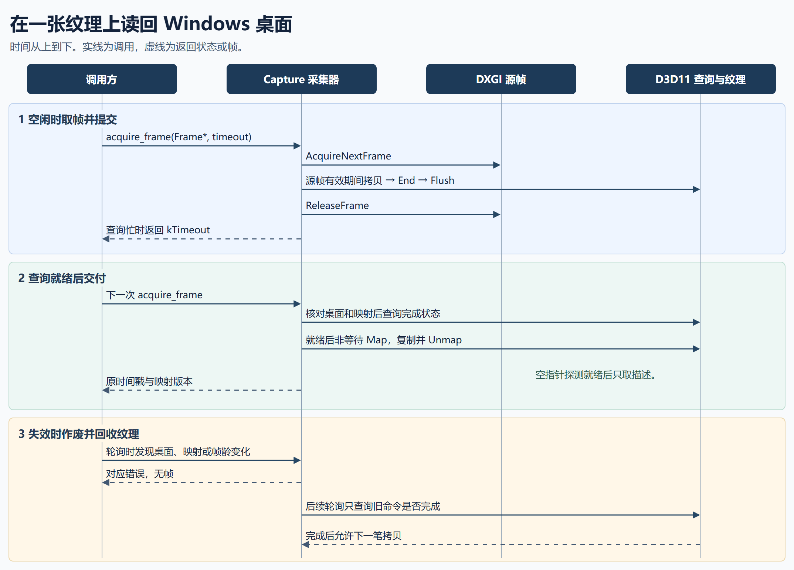
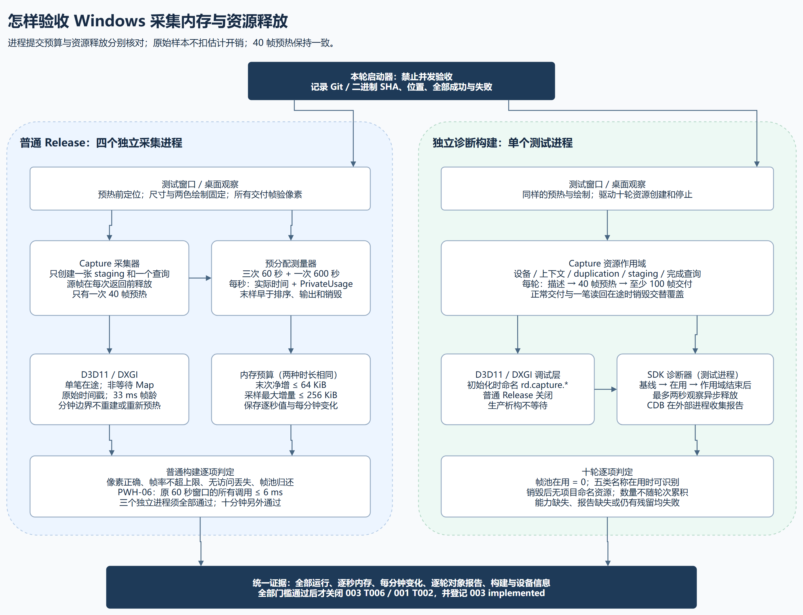

# Windows 屏幕采集与输入注入技术方案

## 规格与工程约束

依据 [003](spec.md)、[002 帧移交](../002-screen-frame-handoff/spec.md) 与 [005 桌面状态](../005-windows-desktop-state/spec.md)。沿用 C++20、Windows SDK 和现有 GoogleTest/GoogleMock。平台接口使用 [平台抽象 §2](../../architecture/platform-abstraction.md#2-错误类型) 的 `PlatformResult<T>`。代码按 Capture 和 Input 分属现有线程。

## 模块与数据流

| 模块 | 职责 |
| --- | --- |
| 公共平台头 `include/remotedesktop/platform/platform.h` | 声明平台值类型、错误、采集和注入接口。业务层只引用平台无关声明 |
| `src/platform/win/screen_capture_win.cpp` | 通过 Windows SDK 后端初始化 DXGI 及 staging 资源。Capture 路径在所有返回分支正确结束对已取得帧的访问，再把写入结果交还调用方 |
| `src/platform/win/input_inject_win.cpp` | 组装 Windows 输入，按平台报告更新固定容量按压表。释放路径逐项确认并保存重试进度 |
| `tests/unit/platform/win/` | 用脚本后端驱动真实采集或注入器。断言错误分支、资源释放顺序、派发内容和重试后的实际结果 |

## 采集与读回时序

[可编辑的 draw.io 时序图](readback-sequence.drawio)

Capture 在源帧释放前提交拷贝和 `D3D11_QUERY_EVENT`。`Flush` 交付命令，`GetData` 确认完成。读取 staging 纹理使用非等待映射。两次调用之间，采集器保存一笔读回的描述和映射版本。旧映射、离开交互桌面或已过 33 ms 的读回作废，完成查询后才可重用纹理。 [资源释放点](spec.md#41-提交桌面帧拷贝与读取像素)

## 技术决策与风险

- 采集和注入的后端替换只在装配时建立。底层通用失败及桌面状态通过各自的输入报告，采集和注入不在热路径同步查询 Session。Windows 适配器以 005 提供的当前代次观察结果作为桌面分类证据。
- 先实现 PW-18、PW-21 的最小红绿循环，对应 M1 T002。后续采集及注入覆盖按任务清单完成。M1U-22 对关断及槽位的断言由 M1 波次 3 负责。
- 部分 `SendInput` 计数只能证明接受数量时，记账保留所有可能仍按下的项。逐项清理提供可观察的失败位置和重试进度。
- D3D11 设备创建使用 `D3D11_CREATE_DEVICE_SINGLETHREADED`，并请求 `D3D11_CREATE_DEVICE_PREVENT_INTERNAL_THREADING_OPTIMIZATIONS`，减少当前只执行桌面拷贝的设备对驱动内部工作线程的依赖。该选项对硬件驱动是请求，仍以 PWH-01 的私有内存及 PWH-06 的实际耗时判定结果。它不改变既有单笔读回和源帧释放顺序。 [设备创建选项](https://learn.microsoft.com/en-us/windows/win32/api/d3d11/ne-d3d11-d3d11_create_device_flag)
- 交互桌面用同一窗口负载记录所有零等待调用的耗时、实际交付帧率、帧龄和丢弃数。`Flush` 只提交命令，其实际耗时计入 6 ms 上限。用独立进程对照绘制、无像素探测和完整读回，并在具备权限时追踪堆和虚拟内存的分配来源。 [D3D11 命令提交](https://learn.microsoft.com/en-us/windows/win32/api/d3d11/nf-d3d11-id3d11devicecontext-flush)

## 内存提交与资源释放验证

[可编辑的 draw.io 验证图](memory-verification.drawio)

2026-11-27 批准的修订将 PWH-01 改为三个固定独立进程，均执行原 40 帧预热及 60 秒负载。每秒记录实际单调时间和完整进程的 `PrivateUsage`；末次净增最多 64 KiB，所有采样相对首样最多增加 256 KiB。记录存储与耗时数组在测量前分配；末样在排序、输出及销毁前读取，不扣减估计的驱动、线程或窗口开销。

PWH-07 使用同一采集器连续 600 秒，只有一次预热及基线，使用相同提交预算。每分钟原始变化和全部统计均保留。PWH-06 的 6 ms 门槛仍只判定原 60 秒窗口。进程预算不能单独证明不存在小额泄漏，项目热路径的分配和引用泄漏仍须修复。

PWH-08 使用独立的 `windows-desktop-diagnostics` 配置及默认关闭的诊断选项。调试层、对象命名只在该构建初始化时启用；测试在每轮销毁作用域后用 SDK 报告观察最多两秒。十轮交替覆盖正常交付和一笔读回在途，逐轮核对帧池归还、五类项目命名资源在用时可识别、销毁后不残留。CDB 收集原始报告，解析器按名称、类型、地址去重；环境能力、报告或必要名称缺失均失败。

启动器只管理自己创建的进程和窗口，记录位置与遮挡，子进程退出后不再操作其 HWND。固定批次中任何失败均保留并终止达标结论。旧设备策略须在新测量器和相同负载下产生超预算断言，判定助手和报告解析器也先保存红灯。

## 验证与交付

按 `debug` 和 `release` 预设分别配置、构建和运行全量 CTest。保留 PW-22–26 原红绿，增加 PW-27、PW-28。普通 `windows-desktop` 用同一交付 SHA 运行三次 PWH-01/06、一次 PWH-07 及 PWH-02–05；独立诊断构建运行十轮 PWH-08。命令、Git/二进制 SHA、补丁、全部成功与失败、时间序列和对象报告写入 `test-results/platform-win/`。全部通过后才关闭 T006/001 T002，并同步登记 003 implemented。 [真机运行说明](../../../tests/integration/platform/win/README.md)
