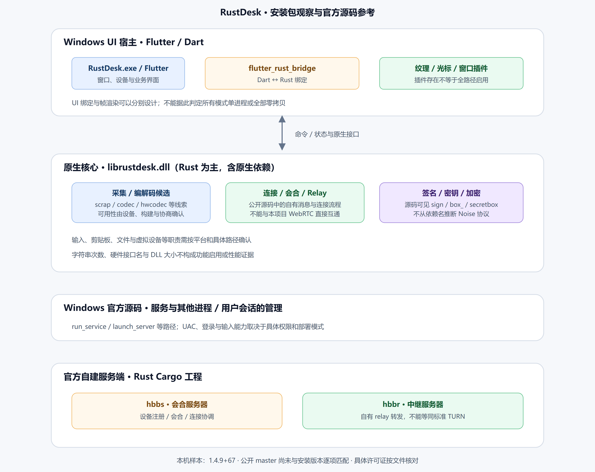

# 跨平台架构参考：RustDesk 安装包观察与源码核对

> **性质：第三方产品观察记录，不是本项目契约。**
> 本目录（`docs/references/`）只存放对外部软件的调查，
> 不构成技术选型依据，也不被 `docs/increments/` 或 `src/` 引用。
> 本项目的架构、线程与协议以[架构总览](../architecture/overview.md)、
> [线程模型](../architecture/threading.md)、[控制协议](../protocol/README.md)为准。

本文保留 2026-11-16 对本机 RustDesk `1.4.9+67` 的安装包观察，
并用官方公开源码交叉核对服务端、连接加密与 Windows 进程职责。
本项目目标架构以[架构总览](../architecture/overview.md)为准。
本文与 [AGENTS.md](../../AGENTS.md) 的技术栈锁定不冲突：文中观察只用于比较职责边界，
不构成对本项目传输、构建或语言的选型建议。

安装包观察与公开源码分开标明。本文链接的 `master` 是可变主分支，
尚未确认与本机 build `29722256` 逐项对应；源码结构不能直接当作该安装版本的运行证据。
RustDesk 主仓库使用 AGPL-3.0，代码复用须核对具体文件及其适用义务，不能概括为“禁止复制”。

## 1. 本机样本

| 项目 | 观察值 |
| --- | --- |
| 产品 | RustDesk |
| 版本 | `1.4.9+67`，build `29722256` |
| 发布者 | Purslane Tech Pte. Ltd. |
| 安装位置 | `D:\Apps\RustDesk\` |
| UI / 核心组件 | Flutter/Dart UI，Rust 为主的原生核心及原生依赖 |

## 2. 组件与职责

[查看高清 PNG](../../assets/references/rustdesk-architecture.png) · [SVG 源图](../../assets/references/rustdesk-architecture.svg)

Windows 安装包包含 `RustDesk.exe`（约 358 KB）、`flutter_windows.dll`（约 17 MB）
和 `librustdesk.dll`（约 35 MB），支持 UI 宿主、Flutter 引擎与原生核心的分层理解。
`flutter_rust_bridge` 相关依赖说明存在 Dart/Rust 绑定，但不能由这些文件推导所有功能都在同一进程，
也不能把 DLL 大小当成维护成本或性能指标。

## 3. UI 插件观察

以下组件来自安装文件或模块观察；不表示每个插件在所有会话中都启用。

| 组件 | 功能线索 |
| --- | --- |
| `window_manager_plugin.dll` | 窗口管理 |
| `screen_retriever_plugin.dll` | 屏幕信息 |
| `desktop_multi_window_plugin.dll` | 多窗口能力；不能仅凭名称确定每会话进程模型 |
| `desktop_drop_plugin.dll` | 文件拖拽 |
| `flutter_gpu_texture_renderer_plugin.dll` | GPU 纹理渲染接口 |
| `texture_rgba_renderer_plugin.dll` | RGBA 纹理渲染接口 |
| `flutter_custom_cursor_plugin.dll` | 光标处理 |
| `uni_links_desktop_plugin.dll` | URL Scheme 相关接口 |
| `url_launcher_windows_plugin.dll` | 外部链接 |
| `file_selector_windows_plugin.dll` | 文件选择 |
| `WindowInjection.dll` | 窗口注入相关组件；具体作用待直接核对 |

纹理插件提示 UI 绑定与视频渲染可以使用不同接口，但不证明任意路径都是零拷贝。
本项目可采用“命令/事件与帧渲染分开”的边界，无需先迁移 Flutter。

## 4. 媒体、网络与加密

### 4.1 媒体能力的证据范围

原二进制扫描发现 `scrap`、codec/convert/hwcodec、FFmpeg、H.264/VP8/VP9/AV1/Opus，
以及 NVENC、AMF、QSV、DXVA、D3D11VA、Vulkan、MediaFoundation 等相关词或依赖路径。
公开仓库的 [`libs/scrap/`](https://github.com/rustdesk/rustdesk/tree/master/libs/scrap)
也提供采集与编解码相关实现。

这些信息是可调查的能力候选，不能证明本机启用了全部格式与硬件路径。
实际可用性还取决于构建特性、平台、驱动、硬件及两端协商，不能当作性能验收结果。
核心包含原生编解码等依赖，因此“核心为纯 Rust”不准确。

### 4.2 自有连接流程与中继

公开源码包含自有消息、会合、打洞和 relay 连接流程；
客户端参考 [`src/client.rs`](https://github.com/rustdesk/rustdesk/blob/master/src/client.rs)。
它不是可直接与本项目 SDP/ICE/SCTP 会话互通的 WebRTC 端点。
RustDesk 的中继服务 hbbr 不能等同于标准 TURN 服务，STUN 依赖也不证明使用了 TURN。

扫描中还出现 rustls/tokio-rustls、tokio-tungstenite、hyper、reqwest、tokio、STUN 与 QUIC 相关线索。
依赖存在不代表某条远控连接实际使用该传输；不能用 WebRTC 或 QUIC 字符串多少比较协议支持程度。
TLS、WebSocket 等具体用途需要对应调用路径或运行证据，本文不将其统一标为媒体或信令通道。

### 4.3 加密结论修正

现有观察不足以将 RustDesk 的端到端加密描述为 Noise，也不能笼统归为 AES/ChaCha。
官方 [`hbb_common/src/tcp.rs`](https://github.com/rustdesk/hbb_common/blob/master/src/tcp.rs)
可见 `box_` 处理密钥材料、`secretbox` 处理加密帧等路径；
客户端的签名相关逻辑见 [`src/client.rs`](https://github.com/rustdesk/rustdesk/blob/master/src/client.rs)。

这说明应沿身份、签名、密钥传递和消息加密分别核对，不能仅凭某个密码库或算法名还原完整协议。
上述主分支证据尚未与本机版本匹配，本文不据此声明已审计其安全性，
也不据此判断它比本项目 DTLS-SRTP 更安全或更灵活。
本项目继续遵循自身设备授权与 DTLS 信任边界，后续指纹绑定另行设计。

### 4.4 会合与中继服务端

| 程序 | 职责 | 源码证据 |
| --- | --- | --- |
| `hbbs` | 设备注册、会合与连接协调 | 官方服务端 Rust Cargo 工程及 `src/` |
| `hbbr` | 中继转发 | 同一 Cargo 工程中的 `src/hbbr.rs` |

两者使用 **Rust**，见 [rustdesk-server/Cargo.toml](https://github.com/rustdesk/rustdesk-server/blob/master/Cargo.toml)。
本项目使用 Go 信令与 coturn，可以参考其职责分离，不复用其协议或根据服务端语言改变选型。

## 5. 驱动、进程与运行权限

### 5.1 虚拟设备组件

| 组件 | 观察到的用途线索 |
| --- | --- |
| `usbmmidd_v2/usbmmIdd.dll` | 虚拟显示器 |
| `dylib_virtual_display.dll` | 虚拟显示用户态接口 |
| `drivers/RustDeskPrinterDriver/` | 远程打印相关驱动 |
| `printer_driver_adapter.dll` | 打印机适配接口 |

本次文件观察未发现与 UU `uuycinput.sys` 对应的独立输入驱动。
但未发现驱动不等于无法处理 UAC 或登录场景；这些能力还涉及安装模式、服务、会话与令牌权限。
本文没有对上述场景完成运行验证。

### 5.2 进程职责

UI 与原生核心可以在同一进程通过绑定通信；这只是 UI 宿主内部的组织方式。
公开 Windows [`src/platform/windows.rs`](https://github.com/rustdesk/rustdesk/blob/master/src/platform/windows.rs)
还包含服务入口、`run_service`、`launch_server`、`launch_privileged_process` 等路径，
涉及服务与其他进程/用户会话的管理，不能概括为“默认所有远控逻辑单进程”。

本项目应单独定义 UI、交互代理与系统服务职责，以及 IPC 授权和资源所有权。
语言的内存安全不能替代进程隔离、关闭完成通知或权限边界。

### 5.3 空闲端口快照

原观察中出现两个绑定 `0.0.0.0` 的随机 UDP 高端口，未观察到 TCP 监听。
这只反映采样时刻：端口用途、会话期间行为和所有部署模式均未确认，
不能把它作为完整的媒体/信令网络拓扑。

## 6. 原字符串与依赖观察的保留口径

下表保留原扫描次数，只用于定位后续调查方向；次数不代表功能启用、完整性或重要程度。

| 检索项 | 原观察次数 | 检索项 | 原观察次数 |
| --- | --- | --- | --- |
| session | 468 | clipboard | 229 |
| audio | 276 | mouse | 144 |
| cursor | 119 | peer | 187 |
| relay | 159 | keyboard | 73 |
| p2p | 51 | rendezvous | 63 |
| virtual_display | 27 | file_transfer | 15 |
| port_forward | 18 | | |

原 `cargo/registry/src/` 路径扫描记录包括：`flutter_rust_bridge 1.80.1`、`protobuf 3.7.2`、
`serde/serde_json 1.0.228`、`windows 0.61.1`、`windows-service 0.6.0`、`muda 0.17.1`、
`shared_memory 0.12.4`、`whoami 1.6.0`、`totp-rs 5.5.1`、`wol-rs 1.0.1`、
`rustls 0.23.28`、`tokio-tungstenite 0.26.2`、`hyper 1.7.0`、`reqwest 0.12.24`、
`tokio 1.44.2`、`ring 0.17.14`、`zeroize 1.8.1`、`stunclient 0.4.1`、`stun_codec 0.3.5`。

这些是原始依赖线索，尚未逐项验证可达调用与功能开关；不能替代构建清单、完整依赖审计或运行确认。
例如共享内存依赖不直接证明捕获帧经过共享内存，TOTP/Wake-on-LAN 依赖也不证明某部署已启用该功能。

## 7. 对本项目的参考价值

| 模式 | 值得采用的边界 | 本项目阶段 |
| --- | --- | --- |
| UI 与核心通过绑定交互 | 业务命令、状态事件和原生帧渲染分开 | M1 明确接口；保留 Android Java |
| 桌面平台适配与公共核心 | 协议、会话、帧接口和统计逐步复用 | M1 从 Windows/Linux 实际重复处抽取 |
| 会合与中继分工 | 控制面协调、媒体中继转发 | 不在 M1；M3 引入时另立规格，不照搬 hbbs/hbbr 协议 |
| 服务与交互进程分工 | 权限、会话与启动管理分别设计 | M1 用户会话代理；服务后续独立设计 |
| 多种编解码候选 | 按设备与瓶颈建立能力矩阵 | M0/M1/M2 依测量安排，不照搬格式列表 |

Flutter/Rust、Qt/WebView 或其他 UI 栈需要按当前团队、平台与原生渲染需求比较，
不能仅以“更现代”决定替换。本项目已按 [AGENTS.md](../../AGENTS.md) 锁定 C++20 + CMake 并自研传输，
该决定的代价（拥塞控制、丢包恢复、NAT 穿透）已在[架构总览](../architecture/overview.md) 4.1 记录；
本文不据此主张改用 RustDesk 的技术栈。

## 8. 证据、许可证与相关参考

- 本机证据：文件清单、版本、模块、依赖字符串、驱动列表与有限的网络状态；未反编译、注入或抓取媒体流量。
- 源码交叉核对：官方主仓库、服务端与 hbb_common 主分支；未将本机 DLL 与对应 commit 重建比对。
- RustDesk 主仓库为 AGPL-3.0；第三方依赖与不同文件可能有独立条款。
  代码复用、修改和分发按具体许可证判断，核对源码提供、许可证通知等义务；本文不将架构参考等同于代码复制。
- [RustDesk 官方仓库与许可证](https://github.com/rustdesk/rustdesk)
- [RustDesk 官方服务端](https://github.com/rustdesk/rustdesk-server)
- [hbb_common 官方仓库](https://github.com/rustdesk/hbb_common)
- [架构总览的关键决策](../architecture/overview.md#4-关键决策)
- [为什么不用 WebRTC](../architecture/overview.md#41-为什么不用-webrtc)
- [CROSS-PLATFORM-REFERENCE.md：UU 远程安装包观察](CROSS-PLATFORM-REFERENCE.md)
